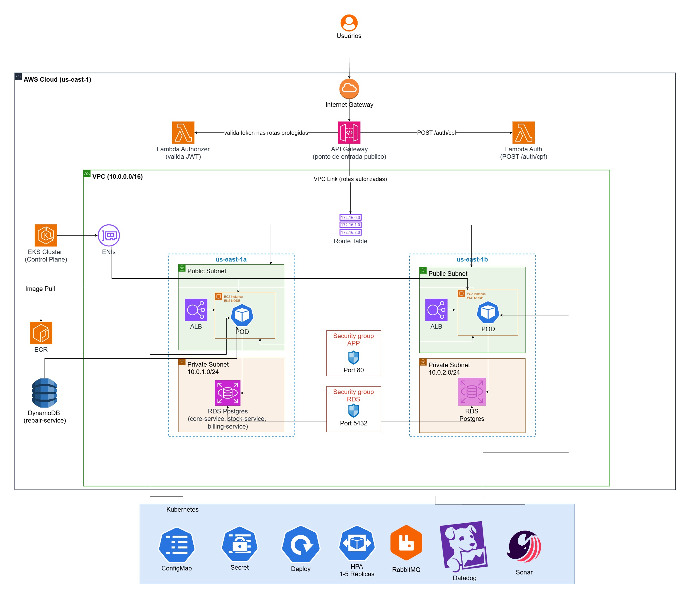
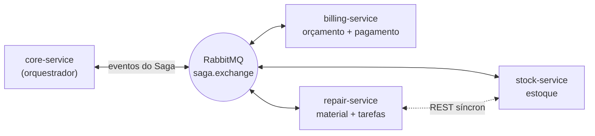
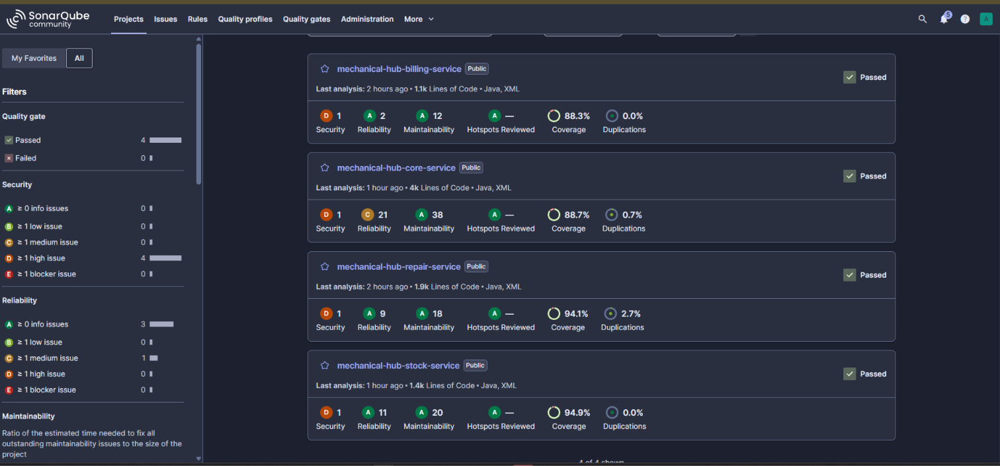

# mechanical-hub-billing-service

Microsserviço de **orçamento e pagamento** do Mechanical Hub (Fase 4 — Tech Challenge). Dono do cálculo/aprovação do orçamento e da integração com o **Mercado Pago**, participante do Saga Pattern orquestrado pelo [`core-service`](https://github.com/estefanyneres/mechanical-hub-core-service).

## Diagrama de infraestrutura



## Arquitetura

Clean Architecture (`domain` / `application` / `infrastructure`):

- **application** — `BudgetUseCase` (cálculo do orçamento, consultando `repair-service` via REST pra saber o que foi selecionado na OS), `PaymentWebhookUseCase`.
- **infrastructure** — PostgreSQL/Flyway, integração Mercado Pago (`MercadoPagoClient`, REST direto — sem SDK), validação de assinatura do webhook (`MercadoPagoSignatureValidator`), segurança (JWT stateless de usuário interno **e** JWT de cliente final para aprovar/recusar orçamento).

### Papel no Saga

1. Escuta `orcamento.solicitado` (core-service, disparado quando o mecânico move a OS pra "Aguardando aprovação") → calcula o orçamento consultando `GET /service-orders/{id}/tasks` no repair-service → publica `orcamento.gerado`
2. Cliente aprova/recusa via `POST /budgets/{serviceOrderId}/approve`\|`reject` (JWT de cliente) → publica `orcamento.aprovado`/`orcamento.recusado`. Aprovação cria a preferência de pagamento no Mercado Pago (Checkout Pro / API de Preferences)
3. `POST /webhooks/mercadopago` (público, fora do authorizer JWT — autenticidade validada pelo header `x-signature`, HMAC-SHA256) recebe a notificação, busca `GET /v1/payments/{id}` pro status real → publica `pagamento.confirmado` ou `pagamento.falhou`

**Publica:** `orcamento.gerado`, `orcamento.aprovado`, `orcamento.recusado`, `pagamento.confirmado`, `pagamento.falhou`
**Consome:** `orcamento.solicitado`

**Diagrama do fluxo** (quem fala com quem):



### Mercado Pago

- Checkout Pro com a **API de Preferences** (não Orders — mais recente, com menos exemplos da comunidade)
- `notification_url`/`back_urls` apontam pra URL pública do API Gateway (`API_GATEWAY_URL`)
- Autenticidade do webhook validada por `x-signature` (`ts=...,v1=<hash>`), segredo **separado** do access token da API (painel Mercado Pago → Webhooks)
- Cartões de teste: `APRO` aprova, `OTHE` recusa, `CONT` fica pendente

## Tecnologias

- Java 21 / Spring Boot 3.2
- PostgreSQL (RDS, `billing_service_db`) via Spring Data JPA + Flyway
- RabbitMQ (Spring AMQP)
- Spring Security (JWT stateless, dois perfis: usuário interno e cliente final)
- Datadog (`dd-java-agent` + Micrometer/statsd)
- springdoc-openapi (Swagger UI)
- JUnit 5 + Mockito + AssertJ

## Rodando localmente

```bash
./mvnw spring-boot:run
```

Variáveis de ambiente em `k8s/configmap.yaml`/`k8s/secret.yaml` (`DB_HOST`/`DB_PORT`/`DB_NAME`, `REPAIR_SERVICE_URL`, `CORE_SERVICE_URL`, `API_GATEWAY_URL`, `MERCADOPAGO_ACCESS_TOKEN`, `MERCADOPAGO_WEBHOOK_SECRET`, `RABBITMQ_HOST`, `JWT_SECRET`).

Swagger UI local: `http://localhost:8080/swagger-ui/index.html`

**Swagger UI público:** output `billing_service_swagger_url` da pipeline do [`api-gateway`](https://github.com/estefanyneres/mechanical-hub-api-gateway) — ALB público dedicado (mesmo motivo do `repair-service`: os 4 serviços servem Swagger no mesmo path). Muda a cada sessão nova do AWS Academy.

## Testes

```bash
./mvnw test
```

**69 testes**, **88,3% de cobertura** (gate SonarQube: 80% em código novo).

**Evidência de cobertura (SonarQube):**



## Deploy

- `Dockerfile` multi-stage (`eclipse-temurin:21-jre-jammy` + `dd-java-agent`)
- `k8s/` — namespace, configmap, secret, deployment, service (NodePort `30084`), HPA
- CI/CD: `feature.yml` (build → testes → SonarQube com gate → PR) e `main.yml` (build → push ECR → deploy EKS)

Exposto publicamente via API Gateway nos paths `/budgets*` e `/webhooks/mercadopago` (este último fora do authorizer JWT, de propósito).

## Documentação de arquitetura

As decisões de arquitetura compartilhadas entre os 4 microsserviços (decomposição de domínio, Saga orquestrado, RabbitMQ, DynamoDB) estão documentadas no repositório do [`core-service`](https://github.com/estefanyneres/mechanical-hub-core-service/tree/main/docs).
